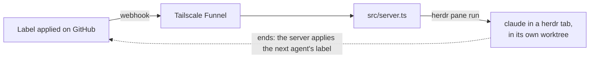
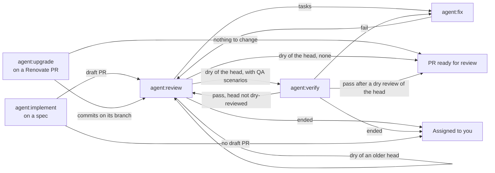

# Claude Agent Factory

Put a label on a GitHub issue or pull request. A Claude Code session on your machine picks it up, as a herdr agent you can watch.



`TRIGGERS` in `src/session.ts` lists each label, the skill it starts, the effort it runs at, and what its session is told.
`NEXT_STEPS` in `src/hand-off.ts` says where each run hands its work item when it ends.

Each session is named `<label> <repo>#<number>`, for example `agent:implement ai#1`.
It runs in a herdr tab labelled `<emoji> #<number> <title>`, the emoji naming the trigger label (🏗️ implement, 🔍 review, 🩹 fix, ⬆️ upgrade, 🧪 verify), in the first workspace with a pane at the clone itself. With none, the server opens a workspace named for the repo, which closes with its last tab.
It works in its own git worktree, `.claude/worktrees/<skill>-<number>`, so two sessions never share a checkout.
Applying the label again reuses that worktree.

## Requirements

- Node, in the range `engines` in the root `package.json` sets. The server runs TypeScript directly, with no build step.
- Claude Code, on an account that can run Opus.
- herdr, running on the factory machine. Each session starts in a new herdr tab. With herdr down, a run fails to start and the server takes its `…ing` label off.
- `gh`, logged in. Repo webhooks work with the default `repo` scope.
- `playwright-cli`, with its browsers: `npm i -g @playwright/cli@latest`, then `playwright-cli install-browser`. The Verifier drives the browser through it.
- Tailscale, logged in. The first `tailscale funnel` run prints a link to allow Funnel on your tailnet.

## Conventions for every project

The server finds everything by convention. Each repo it serves needs:

1. A clone at `$REPOS_DIR/<owner>/<repo>`, matching GitHub's `owner/repo`. With `REPOS_DIR=~/Projects/github`, `acme/app` lives at `~/Projects/github/acme/app`. Sessions run there, not in the folder the server runs from.
2. Claude Code trust. In a folder you haven't trusted, `claude --worktree` exits at once, and the run crashes and asks for the trigger label again.
3. Every label in step 3 of [Add a project](#add-a-project).
4. The pipeline's skills (`create-spec`, `implement-spec`, `implement`, `create-pr`, `review-pr` and `verify-pr`) and the skills those call, pushed to the default branch. A session's worktree starts from it. Ours install from `jd-solanki/ai`; the root `skills-lock.json` lists where the rest come from.
5. `.claude/worktrees/` in `.gitignore`, or every session's worktree shows up as untracked in your clone.
6. A webhook to this server, using the JSON content type, the `issues` and `pull_request` events, and the secret from `.env`.

## Start the factory

Once per machine, from `apps/software-factory`:

```bash
echo "GITHUB_WEBHOOK_SECRET=$(openssl rand -hex 32)" >> .env
echo "REPOS_DIR=$HOME/Projects/github" >> .env
```

Then, from the repository root:

```bash
pnpm factory
```

In a second terminal:

```bash
tailscale funnel --bg 3456   # the PORT in src/session.ts
tailscale funnel status      # prints the public URL
```

`pnpm factory` runs in the foreground, so the factory stops when its terminal closes.

For the first few minutes after you enable Funnel, webhooks can time out before they reach the server.

Once the server is up, `pnpm factory` checks that the internet can reach it, and prints `Reachable from the internet` or why not.
To check again later, such as when a label isn't picked up, run `pnpm factory:check` from the repository root.
`tailscale funnel status` reads only this machine's config, and on a tailnet machine MagicDNS answers for the Funnel URL, so both look fine while the internet can't reach the server.
The check resolves the Funnel URL through public DNS and asks the server whether it is up.
If the host name doesn't resolve, Tailscale's public record for it is gone: run `tailscale funnel reset`, run your `tailscale funnel` commands again, and wait up to 5 minutes for DNS to catch up.

## Add a project

Run these from `apps/software-factory` so `.env` loads. The numbers match the conventions above.

Steps 1 to 3 need write access to the repo:

```bash
set -a; . ./.env; set +a
REPO=owner/repo
FUNNEL_URL="https://$(tailscale status --json | jq -r '.Self.DNSName | rtrimstr(".")')/"

# 1. Clone to the convention path
gh repo clone "$REPO" "${REPOS_DIR:?run from apps/software-factory so .env loads}/$REPO"

# 2. Trust it: accept the prompt, then /exit
(cd "$REPOS_DIR/$REPO" && claude)

# 3. Labels
gh label create issue:spec -R "$REPO" --force -d "Spec an agent implements unattended"
gh label create issue:follow-up -R "$REPO" --force -d "What a PR review left for later, for an agent to implement"
gh label create issue:AFK -R "$REPO" --force -d "Sub-issue an agent does unattended"
gh label create issue:HITL -R "$REPO" --force -d "Sub-issue a human does"
gh label create issue:HITL-done -R "$REPO" --force -d "The human finished this HITL issue"
gh label create agent:implement -R "$REPO" --force -d "Factory: implement this spec and open a draft PR"
gh label create agent:implementing -R "$REPO" --force -d "Factory: an Implementer run holds this spec"
gh label create agent:review -R "$REPO" --force -d "Factory: review this PR"
gh label create agent:reviewing -R "$REPO" --force -d "Factory: a review run holds this PR"
gh label create agent:fix -R "$REPO" --force -d "Factory: fix this PR's review findings"
gh label create agent:fixing -R "$REPO" --force -d "Factory: a Fixer run holds this PR"
gh label create agent:upgrade -R "$REPO" --force -d "Factory: upgrade the code for this Renovate PR (needs ⬆️ Renovate)"
gh label create agent:upgrading -R "$REPO" --force -d "Factory: an Upgrader run holds this PR"
gh label create agent:verify -R "$REPO" --force -d "Factory: try this PR's QA scenarios"
gh label create agent:verifying -R "$REPO" --force -d "Factory: a Verifier run holds this PR"
```

Step 6 needs admin access to the repo, in the same shell:

```bash
# 6. Webhook
HOOK_ID=$(gh api "repos/$REPO/hooks" \
  -f "config[url]=$FUNNEL_URL" -f 'config[content_type]=json' \
  -f "config[secret]=${GITHUB_WEBHOOK_SECRET:?run from apps/software-factory so .env loads}" \
  -f 'events[]=issues' -f 'events[]=pull_request' --jq .id)
```

<details>
<summary>Step 6 without <code>gh</code>, for a repo admin who isn't you</summary>

Send the admin the two values below. The secret signs webhooks for every served repo, so send it privately.

```bash
echo "$FUNNEL_URL"
echo "$GITHUB_WEBHOOK_SECRET"
```

The admin then, on GitHub:

1. Opens the repo's **Settings → Webhooks → Add webhook**.
2. Sets **Payload URL** to the Funnel URL.
3. Sets **Content type** to `application/json`.
4. Sets **Secret** to the secret.
5. Picks **Let me select individual events**, ticks **Issues** and **Pull requests**, and unticks **Pushes**.
6. Leaves **Active** ticked and clicks **Add webhook**.

GitHub sends a ping when the webhook is created. In the webhook's **Recent Deliveries** tab, a ping that reached the server shows response `200`.

</details>

Steps 4 and 5 change the project itself, so commit them there:

```bash
cd "$REPOS_DIR/$REPO"
pnpm dlx skills@latest add <source> --skill <name>   # once per skill
echo '.claude/worktrees/' >> .gitignore
git add -A && git commit -m "chore: set up agent factory" && git push
```

If you ran step 6 with `gh`, check that GitHub reaches the server, in the same shell. A ping answers `200`:

```bash
gh api -X POST "repos/$REPO/hooks/$HOOK_ID/pings"
gh api "repos/$REPO/hooks/$HOOK_ID/deliveries" --jq '.[0] | "\(.event) \(.status_code)"'
```

## Run on more than one machine

GitHub has no failover between webhooks: a repo can hold several, and each one receives every event.
Give each factory machine its own webhook, and decide which one takes the work.

Set up every machine as in [Start the factory](#start-the-factory), with its own `.env`.
On each one, repeat steps 1, 2 and 6 of [Add a project](#add-a-project): its own clone, its own trust, and its own webhook, to its own Funnel URL with its own secret.
The labels, the skills and `.gitignore` live in the repo, so they are done once.

Never run two factories on one repo without one of the setups below: both would start a run on the same work item.

### One machine at a time

You work at home some days and at the office on others, and only the machine you're at is on.

Run `pnpm factory` and Funnel only on the machine you're using.
The other machine's webhook delivery fails and shows as failed in **Recent Deliveries**, and nothing else happens.
To switch machines, stop the factory on one and start it on the other.

### A preferred machine and a fallback

Both machines stay on, and you want the office machine to take the work whenever it is up, with the home machine taking over when it isn't.

In the fallback's `.env`, list the Funnel URLs of its preferred factories, highest first:

```bash
# Home machine's .env. The office machine sets no DEFER_TO, so it takes every delivery it gets.
DEFER_TO=https://office.<tailnet>.ts.net/
```

On every delivery, the fallback asks each listed factory whether it is up, waiting up to 2 seconds each.
If one answers, it replies `Deferred to <url>` and does nothing.
If none answers, it takes the work.
A third machine lists both URLs, office first.
The check asks whether a factory is up, not which repos it serves, so set up every repo on every machine: a repo served only by the fallback is deferred and lost.

To change the order, move `DEFER_TO` to the other machine's `.env` and restart both factories.

A preferred factory that answers the check and then stops before claiming the work item drops that event.
Apply the trigger label again to retry.

## Use it

Apply a trigger label on GitHub:

- `agent:implement` on an issue that carries `issue:spec`, which is what `/create-spec` files, or `issue:follow-up`, which is what `/review-pr` files. The session builds the spec's sub-issues, in parallel where none blocks another, or the spec itself when it has none, and opens a draft PR.
- `agent:review` on a pull request. The review posts each finding as a thread and keeps one summary comment with a score.
- `agent:fix` on a pull request. The session fixes the review's threads.
- `agent:upgrade` on a Renovate PR, which must carry `⬆️ Renovate`: set it in Renovate's `labels` option. The session reads the release notes in its body, and brings the code in line with the new versions.
- `agent:verify` on a pull request. The session tries each QA scenario in its body, ticks the ones that pass, posts each failure as a thread and keeps one QA comment.

You apply the first label. When a run ends, the server reads GitHub and applies the next one:



The review's verdict is a marker in its summary comment, written by `/review-pr`, and QA's is one in its QA comment, written by `/verify-pr`, so each served repo needs the skills that write them.
A run whose next step GitHub doesn't show, such as a review with no verdict of its own, waits on you: the work item is assigned to whoever applied the label, and the factory's one comment on it says what was missing.

When a run starts, the server swaps the trigger label for its `…ing` label.
The run ends when its session stops with no background work left: the server closes the run's herdr tab, takes the `…ing` label off and hands the work item on.
A run whose session ends any other way, such as an API error, a closed tab or herdr stopping, crashes: the label comes off too, the work item is assigned to whoever applied the label, and the factory's one comment on it asks for a retry.
Apply the trigger label again to retry or resume. Applied while the `…ing` label is still on, it is removed and nothing starts.

Then, on the factory machine, each session shows in herdr's agent list, in a tab labelled with its trigger's emoji and work item. Open it there to watch or answer.

```bash
herdr agent list   # sessions and their state
```

Sessions run in auto mode, whatever your default permission mode is. A session waiting on an approval stays stuck until you answer it in herdr.

To add a trigger, add a line to `TRIGGERS` in `src/session.ts` and its next step to `NEXT_STEPS` in `src/hand-off.ts`, create its label in each repo, and restart the server.

## More

- Contributing, project status and known gaps: [`CONTRIBUTING.md`](./CONTRIBUTING.md)
- Commands: the `scripts` block in [`package.json`](./package.json)
